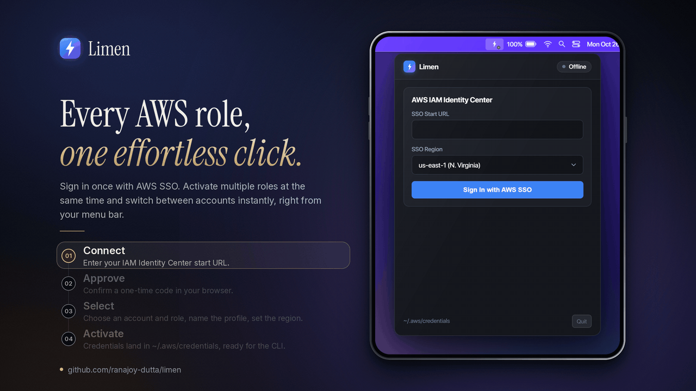

# Limen

[](https://github.com/ranajoy-dutta/limen/actions/workflows/ci.yml)
[](https://www.apple.com/macos/)
[](LICENSE)

<h2 align="center">AWS SSO. Simplified.</h2>

<p align="center">
  Manage profiles and switch IAM roles without the friction.
</p>

<p align="center">
  
</p>

Limen is a lightweight, native macOS menu bar app for **AWS IAM Identity Center (formerly AWS SSO)**. Sign in, discover your accessible AWS accounts and roles, and activate temporary credentials directly into your standard `~/.aws/credentials` file.

Once a role is activated, Limen handles credential delivery automatically. Your existing AWS CLI, SDKs, Terraform, and other compatible tools can use the credentials through the standard AWS configuration.

---

## Features

- **Native macOS experience** — Access Limen directly from the menu bar.
- **Seamless AWS SSO authentication** — Sign in through AWS IAM Identity Center using your organization's SSO Start URL and region.
- **Multi-account role discovery** — Browse the AWS accounts and IAM roles available to you.
- **Instant search** — Find accounts by name, account ID, or role name.
- **Multiple active profiles** — Activate different roles under separate profile names, such as `default`, `staging`, and `prod`, simultaneously.
- **Automatic credential delivery** — Limen retrieves temporary role credentials and writes them to `~/.aws/credentials`. No manual copying of credentials or tokens is required.
- **Works with your AWS tools** — Use activated profiles with the AWS CLI, SDKs, Terraform, and other tools that support standard AWS credentials.
- **Independent session control** — Manage individual active profiles and sign out when you're finished.

---

## Installation

### Homebrew (Recommended)

Install via Homebrew:

```bash
brew install --cask ranajoy-dutta/tap/limen
```

To upgrade to a newer version:

```bash
brew upgrade --cask limen
```

### Download a release

Download the latest installer from [GitHub Releases](https://github.com/ranajoy-dutta/limen/releases).

**DMG installer**

1. Open the downloaded `.dmg` file.
2. Drag `Limen.app` into your `/Applications` folder.
3. Launch Limen from Applications or Spotlight.
> **Note on macOS Gatekeeper:**
> If macOS prevents opening the unsigned `.pkg` installer, right-click (or Control-click) the `.pkg` file and choose **Open**, approve via **System Settings > Privacy & Security > Open Anyway**, or remove the quarantine attribute:
> ```bash
> xattr -d com.apple.quarantine Limen_0.1.0_aarch64.pkg
> ```
**PKG installer**

1. Open the downloaded `.pkg` file.
2. Follow the installer prompts.
3. Launch Limen from Applications or Spotlight.

> **Note on macOS Gatekeeper:**
> If macOS prevents opening the unsigned `.pkg` installer, right-click (or Control-click) the `.pkg` file and choose **Open**, approve via **System Settings > Privacy & Security > Open Anyway**, or remove the quarantine attribute:
> ```bash
> xattr -d com.apple.quarantine Limen_0.1.0_aarch64.pkg
> ```

---

## Getting Started

### 1. Sign in to AWS

1. Open Limen from the macOS menu bar.
2. Enter your organization's AWS IAM Identity Center **SSO Start URL** and **SSO Region**.
3. Click **Sign In with AWS SSO**.
4. Copy the displayed authorization code and click **Open Browser**.
5. Complete authorization in your browser.

Once authorization is complete, Limen displays the AWS accounts and roles available to you.

### 2. Activate an IAM role

1. Browse your AWS accounts or search by account name, account ID, or role.
2. Expand an account to view its IAM roles.
3. Click the activation button next to the role you want to use.
4. Configure the profile name and region as needed.

Limen retrieves temporary AWS role credentials and automatically writes them to `~/.aws/credentials` under the configured profile. You do not need to copy access keys, tokens, or credentials manually.

### 3. Use your credentials

Your activated profile is available to AWS-compatible tools through the standard credentials file.

For example, to use a profile named `staging` with the AWS CLI:

```bash
aws sts get-caller-identity --profile staging
```

Replace `staging` with the profile name you configured in Limen. For the `default` profile, the AWS CLI normally uses it automatically.

The same credentials can be used by compatible AWS SDKs, Terraform, and other tools that support standard AWS profiles.

### 4. Manage sessions

- **Left-click** the menu bar icon to open or close the Limen popover.
- **Right-click** the menu bar icon to access the native context menu.
- **Deactivate** an individual profile when you no longer need that role session.
- **Sign out** to end your active SSO session.
- **Quit** Limen from the popover footer or context menu.

---

## Security & Privacy

- **No third-party telemetry** — Limen does not collect analytics, telemetry, or user data.
- **Temporary AWS credentials** — Credentials are obtained through AWS IAM Identity Center and written to the standard `~/.aws/credentials` file.
- **Local credential storage** — Credentials are stored on your Mac and remain subject to local file permissions and their validity period.
- **Direct AWS integration** — Authentication and role credentials are obtained through AWS services rather than a third-party authentication gateway.

Treat your AWS credentials file as sensitive. Local processes and tools with permission to access valid credentials may be able to use them until they expire or are invalidated.

---

## Support & Contributions

Found a bug or have an idea for an improvement? [Open an issue](https://github.com/ranajoy-dutta/limen/issues).

For security-related concerns, see [SECURITY.md](SECURITY.md).

Contributions are welcome! See [CONTRIBUTING.md](CONTRIBUTING.md) for contribution guidelines.

---

## License

Limen is licensed under the [MIT License](LICENSE).